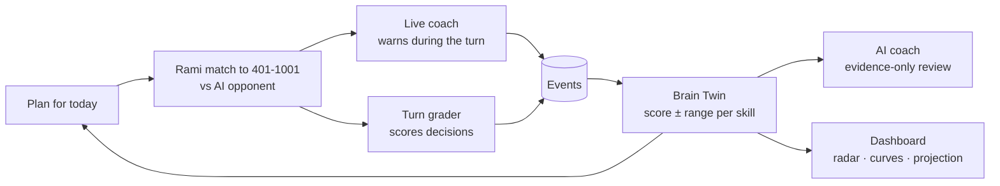
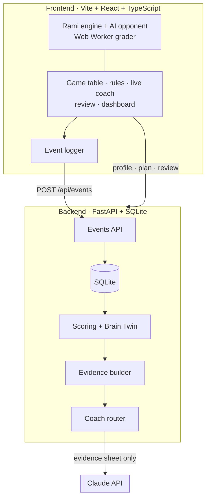

<div align="center">

# AI4Brain × Rami

**Every Tunisian knows Rami. We turned it into a coach for your mind.**

A cognitive growth agent built on the Tunisian Rami card game: play full matches to 401, 501, 701 or 1001 against an AI opponent with your own house rules, get warned live by a coach that only says what it can prove, get every *decision* graded (not your luck), and watch an uncertainty-aware **Brain Twin** of your skills evolve, explained by an AI coach that only speaks from recorded evidence.

[](https://github.com/KareemChatti/Ai4brain-cistac-iset-bizerte/actions/workflows/ci.yml)


Entry for **CISTAC 1.0 · AI4Brain: Cognitive Growth Agent**

</div>

> [!NOTE]
> This is a game and a training tool, **not a medical or psychological test**. It never diagnoses and stores no camera, microphone, real name or contact details: only a nickname.

> [!IMPORTANT]
> 🚧 **In active development.** Phase 1 submission: 1 Nov 2026. Sections marked *planned* are being built.

---

## Table of contents
- [Why Rami](#why-rami)
- [How it works](#how-it-works)
- [The five skills](#the-five-skills)
- [Architecture](#architecture)
- [Getting started](#getting-started)
- [Repository layout](#repository-layout)
- [Responsible AI and data](#responsible-ai-and-data)
- [Roadmap](#roadmap)
- [Team](#team)
- [Documentation](#documentation)
- [License](#license)

## Why Rami
Traditional cognitive tests are one-off and feel like exams. Rami is a game people in Tunisia already play for fun, and every turn naturally exercises memory (what did the opponent pick up?), attention (can I lay this off?), speed, reasoning (which discard gets me out fastest?) and flexibility (switching from a run to a set). Following the chess.com model, we measure the **quality of each decision** against what was possible at that moment, so a lucky deal doesn't inflate the score and a bad one doesn't punish it.

## How it works



| Layer | What it does |
|---|---|
| **A · Assessment** | Signals from every Rami round become 0–100 observations for each skill. A Kalman filter per skill keeps a belief (mean ± uncertainty) that sharpens with data and drifts over time. |
| **A · Brain Twin** | A historised profile with snapshots after every session, plus a what-if projection that always shows its range and disclaimer. |
| **B · AI coach** | An LLM reviews each round using **only** an evidence sheet of recorded facts, cites fact ids, passes guardrails (schema, citations, blocked clinical words) and falls back to a template if the model is unavailable. |
| **Live coach** | During your turn the engine flags only what it can prove: a missed lay-off, a joker swap, an opening you can already make, or a discard that helps your opponent. It asks once before such a discard and never blocks the move. |
| **C · Adaptation** | House rules you choose on the Rules tab, an opponent level that follows wins and losses, a daily plan aimed at the weakest *or* least certain skill, and a gentle break suggestion after frustration signals. |
| **AI Collaboration Score** | 0–100 from how the player works with the hints: asking *why*, verifying, rejecting bad hints, iterating, staying autonomous and using the AI responsibly. |

## The five skills

All five skills are measured from real Rami play:

| Skill | In-game signal |
|---|---|
| Memory | Recall questions during the round, discards that fed the opponent |
| Attention | Missed lay-offs, joker swaps and melds |
| Speed | Think time per available option |
| Reasoning | Graded quality of each discard |
| Flexibility | How long a stale plan is kept |

Every score is shown with its 95% range, e.g. **Memory 68% ± 6**, and labelled "still learning about you" until there is enough data. Formulas: [`docs/scoring.md`](docs/scoring.md).

## Architecture



| Part | Stack |
|---|---|
| Frontend | Vite, React 18, TypeScript, Tailwind CSS, Zustand, React Router, Recharts, Vitest |
| Game engine | Pure TypeScript, heavy evaluation in a Web Worker |
| Backend | Python 3.11, FastAPI, SQLModel + SQLite, Pydantic v2, numpy, pytest |
| Coach LLM | Anthropic Python SDK behind one swappable function |
| Voice (bonus) | Browser Web Speech API |

The full API and data contract is in [`docs/contracts.md`](docs/contracts.md).

## Getting started

**Requirements:** Python 3.11+, Node.js 20+.

### How to run
1. **Backend** (http://localhost:8000, API docs at `/docs`):
   ```bash
   cd backend
   python -m venv .venv
   source .venv/bin/activate        # Windows: .venv\Scripts\activate
   pip install -r requirements.txt
   cp .env.example .env
   uvicorn app.main:app --reload --port 8000
   ```
   In `backend/.env`, `ANTHROPIC_API_KEY` turns on AI-written reviews and chat, and `COACH_MODEL` picks the model. Without a key the coach still works with template reviews built from the same evidence.
2. **Frontend** (http://localhost:5173), in a second terminal:
   ```bash
   cd frontend
   npm install
   cp .env.example .env
   npm run dev
   ```
   In `frontend/.env`, `VITE_API_URL=http://localhost:8000` points at the backend. Set `VITE_USE_MOCK=false` to use it, or `VITE_USE_MOCK=true` to run the whole frontend on the sample data in [`shared/fixtures/`](shared/fixtures/) without a backend.
3. Open http://localhost:5173, pick a nickname, then use **Rules** to choose the match target and house rules, and **Play**.

### Tests
```bash
cd backend && python -m pytest
cd frontend && npx vitest run
```

## Repository layout

```
ai4brain-rami/
├── docs/                 contract, task packs, rules, scoring, ethics
├── shared/               TypeScript types + JSON fixtures (the contract in code)
├── frontend/
│   └── src/
│       ├── engine/       Rami rules, house rules, AI opponent, grader, hints, live coach checks
│       ├── game/         <RamiTable/>, match score to 401/501/701/1001, event logger
│       ├── app/          shell and routes
│       ├── api/          typed client + mock mode
│       ├── coach/        review screen, hint panel, chat
│       ├── dashboard/    Brain Twin charts and goals
│       └── onboarding/   welcome, consent, my data
└── backend/
    ├── app/              FastAPI app, models, routers, scoring, evidence
    │   └── coach/        LLM, prompts, guardrails, fallback
    └── tests/
```

## Responsible AI and data
- **Non-clinical by design:** no diagnosis, no labels, a blocked-word guardrail on every coach output.
- **Uncertainty is always visible:** scores come with ranges, projections with a disclaimer, hints with a confidence and the words "I might be wrong".
- **Evidence-only coaching:** the LLM sees the round's evidence sheet, never the player's nickname, and every claim must cite a recorded fact.
- **Your data, your call:** versioned consent, export everything as JSON, delete everything in one click, automatic retention limits.
- **Non-biometric:** no camera, no microphone.

Details: [`docs/data-and-ethics.md`](docs/data-and-ethics.md) *(planned)*.

## Documentation

| Document | Content |
|---|---|
| [`docs/contracts.md`](docs/contracts.md) | API, events, data shapes, our Rami rules: the source of truth |
| [`docs/challenge-brief.md`](docs/challenge-brief.md) | The official CISTAC 1.0 AI4Brain brief |
| [`docs/starter-kit.md`](docs/starter-kit.md) | How the team works and integration days |
| [`docs/team/`](docs/team/) | Task packs per member |
| [`docs/rami-rules.md`](docs/rami-rules.md) | Rules, matches, house rules and the live coach checks |
| [`docs/scoring.md`](docs/scoring.md) | Uncertainty model and formulas |
| `docs/data-and-ethics.md` | Consent, retention, deletion *(planned)* |

## License
[MIT](LICENSE) © 2026 AI4Brain × Rami team
