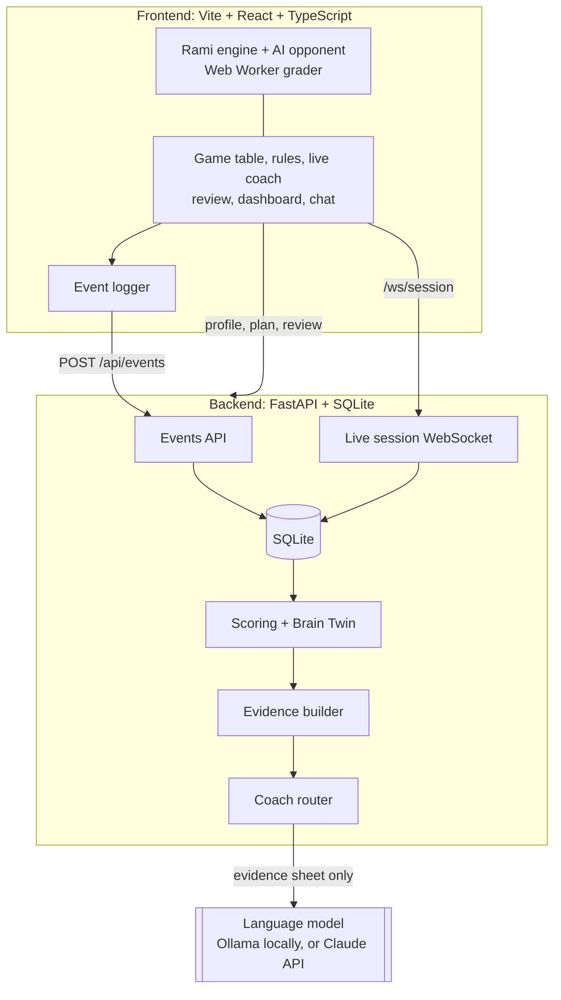

<div align="center">

# AI4Brain × Rami

**Every Tunisian knows Rami. We turned it into a coach for your mind.**

A cognitive growth agent built on the Tunisian Rami card game: play full matches to 401, 501, 701 or 1001 against an AI opponent with your own house rules, get warned live by a coach that only says what it can prove, get every *decision* graded (not your luck), and watch an uncertainty-aware **Brain Twin** of your skills evolve, explained by an AI coach that only speaks from recorded evidence.

[](https://github.com/KareemChatti/Ai4brain-cistac-iset-bizerte/actions/workflows/ci.yml)


Entry for **CISTAC 1.0 · AI4Brain: Cognitive Growth Agent**

</div>

> [!NOTE]
> This is a game and a training tool, **not a medical or psychological test**. It never diagnoses and stores no camera, microphone, real name or contact details: only a nickname.

---

## Table of contents
- [Why Rami](#why-rami)
- [How it works](#how-it-works)
- [The five skills](#the-five-skills)
- [Architecture](#architecture)
- [Getting started](#getting-started)
- [API](#api)
- [Repository layout](#repository-layout)
- [Responsible AI and data](#responsible-ai-and-data)
- [License](#license)

## Why Rami
Traditional cognitive tests are one-off and feel like exams. Rami is a game people in Tunisia already play for fun, and every turn naturally exercises memory (what did the opponent pick up?), attention (can I lay this off?), speed, reasoning (which discard gets me out fastest?) and flexibility (switching from a run to a set). Following the chess.com model, we measure the **quality of each decision** against what was possible at that moment, so a lucky deal doesn't inflate the score and a bad one doesn't punish it.

## How it works


| Layer | What it does |
|---|---|
| **A · Assessment** | Signals from every Rami round become 0–100 observations for each skill. A Kalman filter per skill keeps a belief (mean ± uncertainty) that sharpens with data and drifts over time. |
| **A · Brain Twin** | A historised profile with snapshots after every round, plus a what-if projection that always shows its range and disclaimer. |
| **B · AI coach** | A language model reviews each round using **only** an evidence sheet of recorded facts, cites fact ids, passes guardrails (schema, citations, blocked clinical words) and falls back to a template if the model is unavailable. It also explains hints and answers questions in the Coach chat. |
| **Live coach** | During your turn the engine flags only what it can prove: a missed lay-off, a joker swap, an opening you can already make, or a discard that helps your opponent. It asks once before such a discard and never blocks the move. A WebSocket session streams these warnings to the backend while you play. |
| **C · Adaptation** | House rules you choose on the Rules tab, an opponent level that follows wins and losses, a daily plan aimed at the weakest *or* least certain skill, and a gentle break suggestion after frustration signals. |
| **AI Collaboration Score** | 0–100 from how the player works with the coach: asking *why*, verifying, setting weak hints aside, iterating, playing autonomously and using the AI responsibly. Parts with no data yet are left out. |

## The five skills

All five skills are measured from real Rami play:

| Skill | In-game signal |
|---|---|
| Memory | Recall questions during the round, discards that fed the opponent |
| Attention | Missed lay-offs, joker swaps and melds |
| Speed | Think time per available option |
| Reasoning | Graded quality of each discard |
| Flexibility | How long a stale plan is kept |

Every score is shown with its 95% range, e.g. **Memory 68% ± 6**, and labelled "still learning about you" until there is enough data. Each skill starts at 50 ± 25, every observation narrows the range, and the range widens slowly again on days without play (the range is the mean ± 1.96 standard deviations).

## Architecture



| Part | Stack |
|---|---|
| Frontend | Vite, React 18, TypeScript, Tailwind CSS, Zustand, React Router, Recharts, Vitest |
| Game engine | Pure TypeScript, grading in a Web Worker |
| Backend | Python 3.11, FastAPI, SQLModel + SQLite, Pydantic v2, numpy, pytest |
| Coach model | A local model through [Ollama](https://ollama.com) by default (`qwen2.5:3b`), or Claude through the Anthropic SDK when a key is set; a template fallback when neither is available |
| Voice (bonus) | Round reviews read aloud with the browser Web Speech API |

The shared data contract in code is [`shared/types.ts`](shared/types.ts), with sample payloads in [`shared/fixtures/`](shared/fixtures/).

## Getting started

**Requirements:** Python 3.11+, Node.js 20+. Optional: [Ollama](https://ollama.com) for AI-written coach text.

### How to run
1. **Coach model (optional):**
   ```bash
   ollama pull qwen2.5:3b
   ```
   Without Ollama or an API key the coach still works, with template reviews built from the same evidence.
2. **Backend** (http://localhost:8000, API docs at `/docs`):
   ```bash
   cd backend
   python -m venv .venv
   source .venv/bin/activate        # Windows: .venv\Scripts\activate
   pip install -r requirements.txt
   cp .env.example .env
   uvicorn app.main:app --reload --port 8000
   ```
3. **Frontend** (http://localhost:5173), in a second terminal:
   ```bash
   cd frontend
   npm install
   cp .env.example .env
   npm run dev
   ```
   `VITE_API_URL=http://localhost:8000` points at the backend. Set `VITE_USE_MOCK=false` to use it, or keep `VITE_USE_MOCK=true` to run the whole frontend on the sample data in [`shared/fixtures/`](shared/fixtures/) without a backend.
4. Open http://localhost:5173, pick a nickname, then use **Rules** to choose the match target and house rules, and **Play**.

### Backend settings (`backend/.env`)

| Variable | Default | Purpose |
|---|---|---|
| `DATABASE_URL` | `backend/data.db` (SQLite) | Database location |
| `FRONTEND_URL` | | Extra CORS origins, comma-separated (`http://localhost:5173` is always allowed) |
| `RETENTION_DAYS` | `90` | Raw events older than this are deleted |
| `INACTIVE_DAYS` | `180` | Players inactive this long are deleted with all their data |
| `SEED_DEMO` | `false` | Load simulated demo players at startup |
| `COACH_PROVIDER` | auto | `ollama` or `anthropic`; picks Anthropic when a key is set, Ollama otherwise |
| `OLLAMA_URL` | `http://127.0.0.1:11434` | Ollama server |
| `OLLAMA_MODEL` | `qwen2.5:3b` | Local model |
| `ANTHROPIC_API_KEY` | | Turns on Claude for reviews and chat |
| `COACH_MODEL` | `claude-sonnet-5-5` | Claude model |
| `COACH_TIMEOUT_S` | `60` with Ollama, `15` with Claude | Model timeout in seconds |

Demo players can also be loaded by hand: `python -m scripts.seed_demo` from `backend/`.

### Tests
```bash
cd backend && python -m pytest
cd frontend && npm test && npm run typecheck
```

## API

| Method | Path | Purpose |
|---|---|---|
| `GET` | `/api/health` | Server and coach model status |
| `POST` | `/api/users`, `/api/consent` | Create a player (nickname only), record consent |
| `POST` | `/api/events` | Store game events (duplicate-safe) |
| `WS` | `/ws/session/{user_id}` | Live session during a round |
| `GET` | `/api/profile/{user_id}` | Brain Twin: score, range and trend per skill |
| `GET` | `/api/profile/{user_id}/history`, `/projection` | Snapshots over time, what-if projection |
| `GET` | `/api/plan/{user_id}` | Today's plan |
| `GET` | `/api/matches/{user_id}` | Match history |
| `GET` | `/api/collab/{user_id}` | AI Collaboration Score |
| `GET` | `/api/heatmap/{user_id}`, `/api/goals/{user_id}` | Play-time heatmap, goals (`POST` to set one) |
| `GET` | `/api/evidence/{user_id}/{round_id}` | Evidence sheet for one round |
| `POST` | `/api/coach/review`, `/explain-hint`, `/chat` | Coach review, hint explanation, chat |
| `GET` / `DELETE` | `/api/data/{user_id}/export`, `/api/data/{user_id}` | Export or delete everything |

## Repository layout

```
ai4brain-rami/
├── docs/                 the official challenge brief (PDF)
├── shared/               TypeScript types + JSON fixtures (the contract in code)
├── frontend/
│   └── src/
│       ├── engine/       Rami rules, house rules, AI opponent, grader worker, hints, live coach checks
│       ├── game/         <RamiTable/>, cards, hint panel, card tracker, coach drawer, match score, event logger
│       ├── app/          shell, routes, home, play and rules pages
│       ├── api/          typed client + mock mode
│       ├── coach/        round review, coach chat
│       ├── dashboard/    Brain Twin charts, projection, matches, collaboration score
│       └── onboarding/   welcome, consent, my data
└── backend/
    ├── app/              FastAPI app, models, routers, evidence, live session, retention
    │   ├── scoring/      observations, Brain Twin, projection, plan, goals, heatmap, collaboration score
    │   ├── routers/      HTTP endpoints
    │   └── coach/        language model, prompts, guardrails, template fallback
    ├── scripts/          demo data seeding
    └── tests/
```

## Responsible AI and data
- **Non-clinical by design:** no diagnosis, no labels, a blocked-word guardrail on every coach output.
- **Uncertainty is always visible:** scores come with ranges, projections with a disclaimer, and hints with a confidence and a reminder that the coach can be wrong.
- **Evidence-only coaching:** the model sees the round's evidence sheet, never the player's nickname, and every claim must cite a recorded fact.
- **Your data, your call:** versioned consent, export everything as JSON, delete everything in one click, automatic retention limits.
- **Non-biometric:** no camera, no microphone.

## License
[MIT](LICENSE) © 2026 AI4Brain × Rami team
